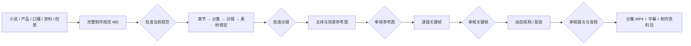

# FrameWeave · 镜织工坊

把小说、产品资料或一个创意，串成从制作规范到成片的可视化流程。

FrameWeave 将 [ai-video-generation](https://github.com/lhh92xcc/ai-video-generation) 的内容/媒体能力和 [web2api-web](https://github.com/lhh92xcc/web2api-web) 的网页账号与云模型连接器集成到新的中文工作台。两个上游以固定版本的 Git submodule 保留，定制界面和编排独立开发，升级上游无需覆盖工作台。


## 创作流程



- **六类起点**：小说 / AI 漫剧与仿真人短剧、电商素材、数字人视频、不露脸知识/科普/解说、治愈/奇幻创意、跨境本地化。
- **规范贯穿**：所有规划与视觉生成提示词携带已批准 Markdown 全文、修订号和 SHA-256；原文完整保存，长文本逐段整理，不静默截断。
- **分集分镜**：全部章节必须覆盖；每集镜头总时长需精确满足目标；角色、场景、产品、道具通过唯一 ID 绑定。
- **参考一致性**：标准素材 → 分镜关键帧 → 视频首帧，按实际文件传递引用。可上传自己的产品图、参考图、视频或配音。人工批准后才进入下一步。
- **可恢复任务**：SQLite 持久化、幂等提交、暂停/恢复/取消、可见失败和手动重试。网关任务保留上游 ID；云请求结果不明时先核对，避免盲目重复扣费。
- **模型策略**：文字、图像、视频分别设置渠道顺序；网页额度优先，也可将付费模型设为首选。付费总开关默认关闭，只有启用后才会调用付费渠道。
- **结果与追溯**：原图/视频预览、审核备注、完整提示词、规范版本、实际模型记录、MP4 下载及项目 ZIP 导出。

## 本机启动

要求：Python 3.11+、[uv](https://docs.astral.sh/uv/)、Node.js 22+、Git、含 `subtitles/libass` 的 FFmpeg。macOS 推荐 `brew install ffmpeg-full`。

```bash
git clone --recurse-submodules https://github.com/lhh92xcc/frameweave.git
cd frameweave
./scripts/bootstrap.sh
python3 scripts/dev.py start
```

打开 **[FrameWeave](http://127.0.0.1:8787)**。macOS 也可双击 `start.command`。安装完成后日常不需要终端配置环境变量。

```bash
python3 scripts/dev.py status
python3 scripts/dev.py stop
```

入口：工作台 `8787`；Web2API 扩展控制台 `8766`；媒体适配器 `8767`。服务默认只监听本机。日志在 `.local/logs/`，项目、结果、账号和密钥均在忽略提交的 `.local/`。

### 首次配置

1. 在 **模型与连接 → 账号与连接** 填写自己的网页登录凭据，或官方视频 API Key。连接器目录直接读取上游，更新后新增平台可自动出现。
2. 在 **生成策略** 分别设置文字、图像、视频渠道与模型 ID。文字规划可用 Gemini 网页，也可用兼容 `chat/completions` 的云模型。
3. 如需付费首选或兜底，启用 **允许付费渠道**。兼容云图像需要支持 `images/generations`，带参考图时需支持 `images/edits`。官方视频模型由网关的供应商专用连接器负责。
4. 新建项目，导入小说或资料；点击 **AI 完善规范**，审核并批准；生成分集分镜后再批准蓝图。开启 **自动生产** 后，会推进到下一个人工审核点。

网页额度、登录状态、模型权限和平台验证由相应服务决定；连接器存在不代表账号一定可用。画面身份、表演、口型、专业内容和本地化质量仍需人工审核。数字人通过视频模型的参考图/原生音频能力生成；本工作台不把未验证的口型输出判为合格。

## OrbStack 部署

macOS 容器运行时使用 [OrbStack](https://orbstack.dev/)，无需 Docker Desktop。OrbStack 提供兼容的 `docker`/Compose 命令：

```bash
open -a OrbStack
docker --context orbstack compose up -d --build
```

详细部署、数据备份、端口和字幕依赖见 [docs/DEPLOYMENT.md](docs/DEPLOYMENT.md)。容器与原生运行二选一，先停止正在运行的版本。不要让两套服务同时写同一数据库。

## 历史素材导入

旧项目的参考图、视频、音频和制作记录可整体迁入，图库支持项目/来源/分集筛选、搜索与分页；可按当前剧本整理选定参考，将待复核、明确返修、动作试片和历史排除分开保存，默认展示当前参考。导入保留原审核状态。操作见 [历史素材导入](docs/IMPORT.md)。

## 合并上游更新

```bash
python3 scripts/dev.py stop
python3 scripts/upstream.py check
# 仅更新一个项目，或把参数改成 all
python3 scripts/upstream.py update web2api-web
git diff --submodule=log
# 验证通过后提交固定版本，其他机器递归更新即可复现
git add upstream upstream-lock.json
git commit -m "chore: update web2api upstream"
git push
python3 scripts/dev.py start
```

更新脚本检查本地改动、拉取上游、安装各自隔离的依赖、重建前端并运行兼容性和编排测试。验证失败会恢复原版本。上游破坏接口时仍需调整适配层，不能承诺任意版本都无需适配。具体策略见 [docs/UPSTREAMS.md](docs/UPSTREAMS.md)。

## 架构与开发

```text
frontend/                       Vue 3 + TypeScript，新工作台
studio/                         API、规范/审核规则、持久化队列、模型路由
services/engine_bridge.py        ai-video-generation 适配边界
upstream/ai-video-generation/    原始内容/媒体引擎，固定提交，不作界面定制
upstream/web2api-web/            原始账号/图像/视频网关，独立 Python 环境
scripts/                        安装、启动、检查和上游升级
.local/                         本机私有数据、日志和隔离环境（不提交）
```

当前统一链路实际复用上游的章节解析、媒体校验、Edge TTS 和 FFmpeg 合成；规划、规范版本和审核编排由 FrameWeave 负责，网页/官方视频模型调用由 Web2API 负责。上游其他实验性能力保留在子模块中，未自动映射成工作台功能；新模式可通过模板与适配器扩展。

```bash
uv run pytest -q
uv run ruff check studio services scripts tests
cd frontend
npm run build
npm run test:e2e
```

后端测试不消耗真实模型额度。浏览器测试使用隔离数据并验证实际工作台；端到端外部模型画质/成功率需要配置账号后实测。验证记录与已知限制见 [docs/VALIDATION.md](docs/VALIDATION.md)，接口见 [docs/API.md](docs/API.md)。

## 开源许可

AGPL-3.0-or-later。Web2API 源码、版权与许可证保留在对应子模块。修改并提供网络服务时，按 AGPL 提供相应源码。依赖和上游致谢见 [NOTICE](NOTICE)。
