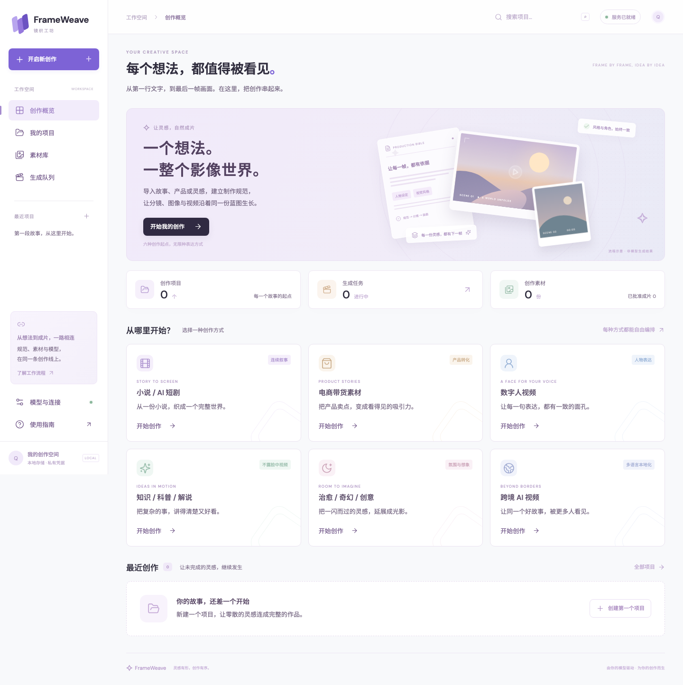
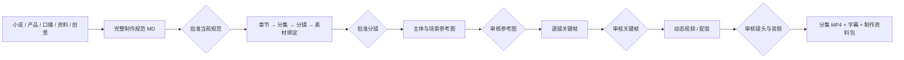

# FrameWeave · 镜织工坊

把小说、产品资料或一个创意，串成从制作规范到成片的可视化流程。

FrameWeave 将 [ai-video-generation](https://github.com/lhh92xcc/ai-video-generation) 的内容/媒体能力和 [web2api-web](https://github.com/lhh92xcc/web2api-web) 的网页账号与云模型连接器集成到新的中文工作台。两个上游以固定版本的 Git submodule 保留，定制界面和编排独立开发，升级上游无需覆盖工作台。



## 创作流程



- **六类起点**：小说 / AI 漫剧与仿真人短剧、电商素材、数字人视频、不露脸知识/科普/解说、治愈/奇幻创意、跨境本地化。
- **规范贯穿**：所有规划与视觉生成提示词携带已批准 Markdown 全文、修订号和 SHA-256；原文完整保存，长文本逐段整理，不静默截断。
- **分集分镜**：全部章节必须覆盖；每集镜头总时长需精确满足目标；角色、场景、产品、道具通过唯一 ID 绑定。
- **参考一致性**：标准素材 → 分镜关键帧 → 视频首帧，按实际文件传递引用。可逐张上传并批准人物多角度、服装、场景和道具参考，逐镜选择额外参考图及已批准的前镜关键帧；绑定或上游审核变化会使相关结果失效。参考图可在批准规范和蓝图前上传，但必须在批准后才能用于生产。上传原图未批准时不会悄悄改成纯文字生成。
- **图片自动初检**：配置支持图像输入的视觉质检渠道后，参考图与关键帧先对照完整规范和实际参考文件检查身份、服装、场景、道具、连续性、构图及剧情；不通过或无法确认时定向修正提示词，最多按设置次数生成。初检通过后仍需人工审核；质检不可用、结果不完整或达到上限时暂停，候选和原因在任务详情中保留。自动初检可能出错，也不能保证视频逐帧一致。
- **费用保护**：图片任务默认预计预算为 0 元。启用可能付费的渠道时，需填写每个渠道的单次最高预计费用和每张图的预计预算；提交前按上限预留，重试与兜底均计入。预估只能约束工作台的提交决策，不能限制或保证供应商实际账单。
- **可恢复任务**：SQLite 持久化、幂等提交、暂停/恢复/取消、可见失败和手动重试。网关任务保留上游 ID；云请求结果不明时先核对，避免盲目重复扣费。
- **模型策略**：文字、图像、视频分别设置渠道顺序；网页额度优先，也可将付费模型设为首选。付费总开关默认关闭，只有启用后才会调用付费渠道。
- **结果与追溯**：原图/视频预览、审核备注、完整提示词、规范版本、实际模型记录、MP4 下载及项目 ZIP 导出。

图片和视频卡片、素材库及详情显示素材记录的最终生成来源和模型；实际由 Seedream 兜底时显示 Seedream 和付费标记，而非最初尝试的 Gemini。用户上传和历史导入素材分别标记，缺少来源记录时显示未知；供应商未返回实际模型时仅展示记录模型，不推断账单或真实模型版本。

素材参考阶段先选择上传分类再上传并批准；关键帧卡片的“配置多角度参考与前镜”可整理已有参考图的分类、审核并逐镜选择。分类只表示用户标注，不代表系统已自动生成齐全的多角度参考，也不能保证模型锁定每一个细节。

## 本机启动

要求：Python 3.11+、[uv](https://docs.astral.sh/uv/)、Node.js 22+、Git、含 `subtitles/libass` 的 FFmpeg。macOS 推荐 `brew install ffmpeg-full`。

```bash
git clone --recurse-submodules https://github.com/lhh92xcc/frameweave.git
cd frameweave
./scripts/bootstrap.sh
python3 scripts/dev.py start
```

打开 **[FrameWeave](http://127.0.0.1:8787)**。macOS 也可双击 `start.command`。安装完成后日常不需要终端配置环境变量。

```bash
python3 scripts/dev.py status
python3 scripts/dev.py stop
```

入口：工作台 `8787`；Web2API 扩展控制台 `8766`；媒体适配器 `8767`。服务默认只监听本机。日志在 `.local/logs/`，项目、结果、账号和密钥均在忽略提交的 `.local/`。

侧边栏内容超出屏幕时可独立滚动；手机上先展开导航再上下滑动。最近项目最多显示四项，全部项目可在 **我的项目** 中查看。

### 首次配置

1. 在 **模型与连接 → 账号与连接** 填写自己的网页登录凭据，或官方视频 API Key。Gemini 网页支持添加并分别检查、编辑、启停多个账号；当前网关最多保存 8 个账号，停用不会删除，其他连接器目前各保存一套凭据。连接器目录直接读取上游，更新后新增平台可自动出现。
2. 在 **模型与连接 → 生成策略 → 图片自动质检** 设置视觉质检渠道。模型必须支持图片输入：网页渠道通过参考图附件，云渠道使用兼容 `chat/completions` 的多模态输入；候选及绑定参考图会发送到该渠道。设置每图生成次数上限（默认 3，最多 5）。如启用付费渠道或 Gemini 付费兜底，还需填写渠道单次最高预计费用和每图预计预算；不填则不提交可能付费的请求。
3. 如需付费首选或兜底，启用 **允许付费渠道**。兼容云图像需要支持 `images/generations`，带参考图时需支持 `images/edits`。官方视频模型由网关的供应商专用连接器负责。
4. 新建项目，导入小说或资料；点击 **AI 完善规范**，审核并批准；生成分集分镜后再批准蓝图。开启 **自动生产** 后，会推进到下一个人工审核点。

项目工作台的 **生产进度** 自动刷新，展示排队、生成、成功、失败及待处理任务、最近执行记录和失败原因；展开任务可查看完整事件。素材阶段分别统计已有结果、待审核和已批准，生成成功不代表审核通过。自动推进遇到失败会等待手动重试；提交结果不明时，先在供应商侧核对任务和账单，避免重复请求。工作线程未运行或安排下一步失败也会在项目内提示。

素材参考和关键帧支持勾选当前页面的待审核结果，批量批准或标记返工，并可填写统一备注。每项仍独立验证版本和审核状态；部分失败会列出原因，不覆盖已审核或过期素材。项目开启自动推进时，批准后可能继续生成并产生费用，确认前会提示。

点击任务的 **重试** 时，工作台先检查网关任务：仍在运行或已成功的任务继续查询原结果；确认失败或已取消且结果明确的任务创建新一轮请求。网关不可用或供应商结果可能不明时不会自动重提，请先核对网页记录和账单。多次点击同一轮重试不会重复创建并行任务；新请求仍可能消耗额度。

网页额度、登录状态、模型权限和平台验证由相应服务决定；连接器存在不代表账号一定可用。画面身份、表演、口型、专业内容和本地化质量仍需人工审核。数字人通过视频模型的参考图/原生音频能力生成；本工作台不把未验证的口型输出判为合格。

Gemini 账号池由网关按添加顺序优先尝试已启用账号，额度不足等情况下可切换其他账号。网关在部分超时情况下也可能切换账号，产生重复请求或消耗额度；遇到结果不明时应检查网页记录。账号连接检查不代表模型生成一定成功。

**账号与连接 → Seedream 付费兜底**直接读取和修改 Web2API 的配置，密钥只由网关保存，不向工作台回显。至少两个已启用 Gemini 账号在本次生图均确认额度耗尽时，网关可使用 Seedream；工作台任务还支持所有启用账号（至少两个）均登录失效时兜底。超时、结果不明或其他原因的账号不可用不会触发登录失效兜底。使用前须在工作台开启并保存“允许付费渠道”，配置成功不代表密钥或余额已验证。关闭付费时，已配置网关兜底会阻止 Gemini 生图；成功兜底的素材记录实际 Seedream 模型和付费属性。Seedream 已提交后失败或结果不明须先核对供应商记录及账单，避免重复扣费。

## OrbStack 部署

macOS 容器运行时使用 [OrbStack](https://orbstack.dev/)，无需 Docker Desktop。OrbStack 提供兼容的 `docker`/Compose 命令：

```bash
open -a OrbStack
docker --context orbstack compose up -d --build
```

详细部署、数据备份、端口和字幕依赖见 [docs/DEPLOYMENT.md](docs/DEPLOYMENT.md)。容器与原生运行二选一，先停止正在运行的版本。不要让两套服务同时写同一数据库。

## 历史素材导入

旧项目的参考图、视频、音频和制作记录可整体迁入，图库支持项目/来源/分集筛选、搜索与分页。默认“当前素材”展示选定参考和待复核候选，卡片保留各自审核状态；明确返修、旧版试片与历史排除单列。默认下载也包含待复核候选，不将待复核误当成废弃。操作见 [历史素材导入](docs/IMPORT.md)。

## 云端素材存储

在 **模型与连接 → 云端存储** 配置腾讯云 COS，可将指定素材和预览图上传、完整读回核验，并通过私有桶临时链接预览和播放。支持缺少本地原文件时的临时依赖下载与 ZIP 导出。上传保留原审核状态和本地副本，默认不自动备份其他项目，也不自动删除文件。迁移命令、范围、生命周期与恢复索引见 [云端存储](docs/CLOUD_STORAGE.md)。

## 合并上游更新

```bash
python3 scripts/dev.py stop
python3 scripts/upstream.py check
# 仅更新一个项目，或把参数改成 all
python3 scripts/upstream.py update web2api-web
git diff --submodule=log
# 验证通过后提交固定版本，其他机器递归更新即可复现
git add upstream upstream-lock.json
git commit -m "chore: update web2api upstream"
git push
python3 scripts/dev.py start
```

更新脚本检查本地改动、拉取上游、安装各自隔离的依赖、重建前端并运行兼容性和编排测试。验证失败会恢复原版本。上游破坏接口时仍需调整适配层，不能承诺任意版本都无需适配。具体策略见 [docs/UPSTREAMS.md](docs/UPSTREAMS.md)。

## 架构与开发

```text
frontend/                       Vue 3 + TypeScript，新工作台
studio/                         API、规范/审核规则、持久化队列、模型路由
services/engine_bridge.py        ai-video-generation 适配边界
upstream/ai-video-generation/    原始内容/媒体引擎，固定提交，不作界面定制
upstream/web2api-web/            原始账号/图像/视频网关，独立 Python 环境
scripts/                        安装、启动、检查和上游升级
.local/                         本机私有数据、日志和隔离环境（不提交）
```

当前统一链路实际复用上游的章节解析、媒体校验、Edge TTS 和 FFmpeg 合成；规划、规范版本和审核编排由 FrameWeave 负责，网页/官方视频模型调用由 Web2API 负责。上游其他实验性能力保留在子模块中，未自动映射成工作台功能；新模式可通过模板与适配器扩展。

```bash
uv run pytest -q
uv run ruff check studio services scripts tests
cd frontend
npm run build
npm run test:e2e
```

后端测试不消耗真实模型额度。浏览器测试使用隔离数据并验证实际工作台；端到端外部模型画质/成功率需要配置账号后实测。验证记录与已知限制见 [docs/VALIDATION.md](docs/VALIDATION.md)，接口见 [docs/API.md](docs/API.md)。

## 开源许可

AGPL-3.0-or-later。Web2API 源码、版权与许可证保留在对应子模块。修改并提供网络服务时，按 AGPL 提供相应源码。依赖和上游致谢见 [NOTICE](NOTICE)。
