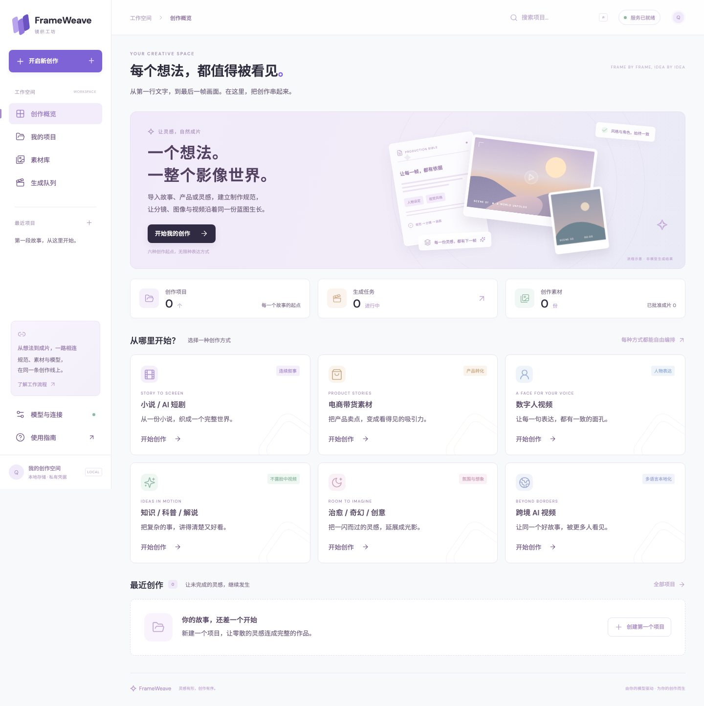
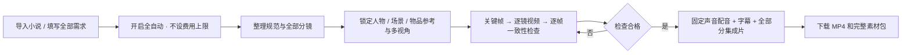

# FrameWeave · 镜织工坊

导入小说，或写下猫咪短视频、产品介绍等需求，一键自动完成参考图、全部镜头、配音、字幕和成片。

FrameWeave 将 [ai-video-generation](https://github.com/lhh92xcc/ai-video-generation) 的内容/媒体能力和 [web2api-web](https://github.com/lhh92xcc/web2api-web) 的网页账号与云模型连接器集成到新的中文工作台。两个上游以固定版本的 Git submodule 保留，定制界面和编排独立开发，升级上游无需覆盖工作台。



## 创作流程



**推荐入口**：新建时勾选“全自动完成 · 不设费用上限”，或在已有项目点击开启。无需逐步手动批准；按项目授权付费渠道与持续返工，保留一致性检查、音色限制和未知提交核对。也可继续使用原有逐步制作。详细流程、恢复与实际边界见 [全自动制作](docs/AUTOMATION.md)。

- **六类起点**：小说 / AI 漫剧与仿真人短剧、电商素材、数字人视频、不露脸知识/科普/解说、治愈/奇幻创意、跨境本地化。
- **规范贯穿**：所有规划与视觉生成提示词携带已批准 Markdown 全文、修订号和 SHA-256；原文完整保存，长文本逐段整理，不静默截断。
- **分集分镜**：全部章节必须覆盖；每集镜头总时长需精确满足目标；角色、场景、产品、道具通过唯一 ID 绑定。
- **参考一致性**：标准素材 → 分镜关键帧 → 视频首帧，按实际文件传递引用。可逐张上传并批准人物多角度、服装、场景和道具参考，逐镜选择额外参考图及已批准的前镜关键帧；绑定或上游审核变化会使相关结果失效。参考图可在批准规范和蓝图前上传，但必须在批准后才能用于生产。上传原图未批准时不会悄悄改成纯文字生成。
- **逐步模式图片检查**：配置支持图像输入的视觉质检渠道后，参考图与关键帧先对照完整规范和实际参考文件检查身份、服装、场景、道具、连续性、构图及剧情；不通过或无法确认时定向修正提示词，最多按设置次数生成。逐步模式首次母版待人工确认，派生参考图和关键帧质检通过后自动批准；人工否决会自动返工并沿用剩余次数与预算。质检不可用、结果不完整或达到上限时暂停，候选和原因在任务详情中保留。自动初检可能出错，也不能保证视频逐帧一致。
- **逐步模式费用保护**：图片任务默认预计预算为 0 元。启用可能付费的渠道时，需填写每个渠道的单次最高预计费用和每张图的预计预算；提交前按上限预留，重试与兜底均计入。预估只能约束工作台的提交决策，不能限制或保证供应商实际账单。
- **可恢复任务**：SQLite 持久化、幂等提交、暂停/恢复/取消、可见失败和手动重试。网关任务保留上游 ID；云请求结果不明时先核对，避免盲目重复扣费。
- **模型策略**：文字、图像、视频分别设置渠道顺序；网页额度优先，也可将付费模型设为首选。付费总开关默认关闭；逐步模式须启用，全自动模式使用本项目明确的不限费用授权。
- **结果与追溯**：原图/视频预览、审核备注、完整提示词、规范版本、实际模型记录、MP4 下载及项目 ZIP 导出。

图片和视频卡片、素材库及详情显示素材记录的最终生成来源和模型；实际由 Seedream 兜底时显示 Seedream 和付费标记，而非最初尝试的 Gemini。用户上传和历史导入素材分别标记，缺少来源记录时显示未知；供应商未返回实际模型时仅展示记录模型，不推断账单或真实模型版本。

逐步制作时，素材参考阶段先选择上传分类再上传并批准；关键帧卡片的“配置多角度参考与前镜”可整理已有参考图的分类、审核并逐镜选择。分类只表示用户标注，不代表视角已齐全；全自动会生成并检查必备视角。模型仍可能误判细节。

同一角色、场景或镜头有多张图片时，卡片显示总张数、视角与审核状态，可点缩略图或前后按钮切换，并查看原图；手机上单列显示，缩略图可横向滑动。手动切换后，自动刷新保留正在浏览的图片；审核操作对应所选图片。过期图片可预览和下载，不能批准，历史导入素材仍在素材库查看。浏览切换不改变生产参考绑定。

所有项目默认锁定角色、场景、产品与道具母版，并逐资产检查身份、外观、剧情状态与空间关系；新候选不会自动替换母版，同集自动承接上一镜。需要强制多视角时，可在完整制作规范中加入结构化参考规则：缺已批准母版禁止文字生图；派生视角始终继承同一母版；必备视角未齐、重复文件或前镜未批准时停止剧情图生成。工作台按角色展示各视角小图和批准进度，点击小图放大与审核；缺少视角显示占位，待审核和来源失效分别标记，规则说明可展开。以本地角色参考卡传递多个视角，保留每张原图的审核版本及文件哈希。见 [强制参考规范](docs/REFERENCE_CONSISTENCY.md)。自动生产会在母版批准后补齐缺失派生视角。模型和视觉质检仍可能出错，可人工复核并否决自动批准结果。

## 本机启动

要求：Python 3.11+、[uv](https://docs.astral.sh/uv/)、Node.js 22+、Git、含 `subtitles/libass` 的 FFmpeg。macOS 推荐 `brew install ffmpeg-full`。

```bash
git clone --recurse-submodules https://github.com/lhh92xcc/frameweave.git
cd frameweave
./scripts/bootstrap.sh
python3 scripts/dev.py start
```

打开 **[FrameWeave](http://127.0.0.1:8787)**。macOS 也可双击 `start.command`。安装完成后日常不需要终端配置环境变量。

```bash
python3 scripts/dev.py status
python3 scripts/dev.py stop
```

入口：工作台 `8787`；Web2API 扩展控制台 `8766`；媒体适配器 `8767`。服务默认只监听本机。日志在 `.local/logs/`，项目、结果、账号和密钥均在忽略提交的 `.local/`。

侧边栏内容超出屏幕时可独立滚动；手机上先展开导航再上下滑动。最近项目最多显示四项，全部项目可在 **我的项目** 中查看。

创作概览用于开始或继续作品；我的项目按制作状态筛选；素材库直接下载成片、图片和声音；生成队列说明正在做什么、是否需要处理；模型与连接从首次配置清单开始。每页的入口与常见处理方法见 [工作台使用指南](docs/UI_GUIDE.md)。

### 首次配置

1. 打开 **模型与连接 → 从这里开始**，按三步清单配置。先在 **账号与连接** 填写自己的网页登录凭据，或官方视频 API Key。Gemini 网页支持添加并分别检查、编辑、启停多个账号；当前网关最多保存 8 个账号，停用不会删除，其他连接器目前各保存一套凭据。连接器目录直接读取上游，更新后新增平台可自动出现。
2. 在清单中分别点击 **写故事和分镜、画人物、场景和镜头、检查画面是否一致、把画面做成视频**，展开对应设置。画面检查模型必须支持图片输入：网页渠道通过参考图附件，云渠道使用兼容 `chat/completions` 的多模态输入；候选及绑定参考图会发送到该渠道。每批图片默认最多尝试 3 次，设置上限为 5；全自动失败后继续下一批。逐步模式使用付费渠道时还需填写渠道单次最高预计费用和每图预计预算。修改后点击 **立即保存** 或 **保存生成策略**；清单的“已填配置”不代表真实生成已验证。
3. 逐步模式需要付费首选或兜底时，启用 **允许付费渠道**；全自动入口单独授权本项目，不需要打开全局付费开关。兼容云图像需要支持 `images/generations`，带参考图时需支持 `images/edits`。TokenHub 视频由工作台直接调用，其余官方视频渠道由网关的供应商专用连接器负责。
4. 新建项目，导入小说或填写视频需求，勾选 **全自动完成 · 不设费用上限** 后开始。系统自动整理规范、分镜、全部多视角参考、逐镜视频、配音和字幕，检查通过后合成每一集；项目首页查看进度和下载。逐步模式仍可按规范、分镜、参考、镜头逐项检查。

项目工作台的 **生产进度** 自动刷新，展示排队、生成、成功、失败及待处理任务、最近执行记录和失败原因；展开任务可查看完整事件。素材阶段分别统计已有结果、待审核和已批准，生成成功不代表审核通过。全自动对一致性失败和可恢复故障自动返工，逐步模式等待手动处理；提交结果不明时，先在供应商侧核对任务和账单，避免重复请求。工作线程未运行或安排下一步失败也会在项目内提示。

素材参考和关键帧支持勾选当前页面的待审核结果，批量批准或标记返工，并可填写统一备注。每项仍独立验证版本和审核状态；部分失败会列出原因，不覆盖已审核或过期素材。项目开启自动推进时，批准后可能继续生成并产生费用，确认前会提示。

点击任务的 **重试** 时，工作台先检查网关任务：仍在运行或已成功的任务继续查询原结果；确认失败或已取消且结果明确的任务创建新一轮请求。网关不可用或供应商结果可能不明时不会自动重提，请先核对网页记录和账单。多次点击同一轮重试不会重复创建并行任务；新请求仍可能消耗额度。

网页额度、登录状态、模型权限和平台验证由相应服务决定；连接器存在不代表账号一定可用。画面身份、表演、口型、专业内容和本地化质量仍需人工审核。数字人通过视频模型的参考图/原生音频能力生成；本工作台不把未验证的口型输出判为合格。

Gemini 账号池由网关按添加顺序优先尝试已启用账号，额度不足等情况下可切换其他账号。网关在部分超时情况下也可能切换账号，产生重复请求或消耗额度；遇到结果不明时应检查网页记录。账号连接检查不代表模型生成一定成功。

**账号与连接 → Seedream 付费兜底**直接读取和修改 Web2API 的配置，密钥只由网关保存，不向工作台回显。至少两个已启用 Gemini 账号在本次生图均确认额度耗尽时，网关可使用 Seedream；工作台任务还支持所有启用账号（至少两个）均登录失效时兜底。超时、结果不明或其他原因的账号不可用不会触发登录失效兜底。使用前须在工作台开启并保存“允许付费渠道”，配置成功不代表密钥或余额已验证。关闭付费时，已配置网关兜底会阻止 Gemini 生图；成功兜底的素材记录实际 Seedream 模型和付费属性。Seedream 已提交后失败或结果不明须先核对供应商记录及账单，避免重复扣费。

## OrbStack 部署

macOS 容器运行时使用 [OrbStack](https://orbstack.dev/)，无需 Docker Desktop。OrbStack 提供兼容的 `docker`/Compose 命令：

```bash
open -a OrbStack
docker --context orbstack compose up -d --build
```

详细部署、数据备份、端口和字幕依赖见 [docs/DEPLOYMENT.md](docs/DEPLOYMENT.md)。容器与原生运行二选一，先停止正在运行的版本。不要让两套服务同时写同一数据库。

## 历史素材导入

旧项目的参考图、视频、音频和制作记录可整体迁入，图库支持项目/来源/分集筛选、搜索与分页。默认“当前素材”展示选定参考和待复核候选，卡片保留各自审核状态；明确返修、旧版试片与历史排除单列。默认下载也包含待复核候选，不将待复核误当成废弃。操作见 [历史素材导入](docs/IMPORT.md)。

## 云端素材存储

在 **模型与连接 → 云端存储** 配置腾讯云 COS，可将指定素材和预览图上传、完整读回核验，并通过私有桶临时链接预览和播放。支持缺少本地原文件时的临时依赖下载与 ZIP 导出。上传保留原审核状态和本地副本，默认不自动备份其他项目，也不自动删除文件。迁移命令、范围、生命周期与恢复索引见 [云端存储](docs/CLOUD_STORAGE.md)。

## 合并上游更新

```bash
python3 scripts/dev.py stop
python3 scripts/upstream.py check
# 仅更新一个项目，或把参数改成 all
python3 scripts/upstream.py update web2api-web
git diff --submodule=log
# 验证通过后提交固定版本，其他机器递归更新即可复现
git add upstream upstream-lock.json
git commit -m "chore: update web2api upstream"
git push
python3 scripts/dev.py start
```

更新脚本检查本地改动、拉取上游、安装各自隔离的依赖、重建前端并运行兼容性和编排测试。验证失败会恢复原版本。上游破坏接口时仍需调整适配层，不能承诺任意版本都无需适配。具体策略见 [docs/UPSTREAMS.md](docs/UPSTREAMS.md)。

## 架构与开发

独立配音支持 MiniMax `speech-2.8-turbo` / `speech-2.8-hd` 同步 HTTP 接口。填写 API Key 后可读取音色，在项目“角色配音”中分别选声线、设置说话者、调整情绪与语速并生成一句试音。结果不明时不自动重发；改声线使相关配音与成片失效。见 [MiniMax 短剧配音](docs/MINIMAX.md)。

**素材库 → 已保存的角色声音**只读保存已激活的定制音色 ID、参数、试听和首次计费回执，可在各项目“角色配音”中直接复用并下载本地备份。保存与播放已有试听不调用生成接口；新台词仍按字符计费；本项目长期规则禁止再新建或复刻音色。已绑定的资源库 ID 由服务端校验，不自动重新设计音色。

长期规则禁止新增定制、设计、克隆及激活其他自定义音色；新增角色只选免音色费的系统音色或已有录音，已付费音色继续复用。未确认的音色 ID 在 TTS 前拦截。猫叫等角色可选“已有录音”，避免被当作人声合成；新台词的 TTS 字符费另计。

```text
frontend/                       Vue 3 + TypeScript，新工作台
studio/                         API、规范/审核规则、持久化队列、模型路由
services/engine_bridge.py        ai-video-generation 适配边界
upstream/ai-video-generation/    原始内容/媒体引擎，固定提交，不作界面定制
upstream/web2api-web/            原始账号/图像/视频网关，独立 Python 环境
scripts/                        安装、启动、检查和上游升级
.local/                         本机私有数据、日志和隔离环境（不提交）
```

当前统一链路实际复用上游的章节解析、媒体校验、Edge TTS 和 FFmpeg 合成；规划、规范版本和审核编排由 FrameWeave 负责，网页/官方视频模型调用由 Web2API 负责。上游其他实验性能力保留在子模块中，未自动映射成工作台功能；新模式可通过模板与适配器扩展。

```bash
uv run pytest -q
uv run ruff check studio services scripts tests
cd frontend
npm run build
npm run test:e2e
```

后端测试不消耗真实模型额度。浏览器测试使用隔离数据并验证实际工作台；端到端外部模型画质/成功率需要配置账号后实测。验证记录与已知限制见 [docs/VALIDATION.md](docs/VALIDATION.md)，接口见 [docs/API.md](docs/API.md)。

## 开源许可

AGPL-3.0-or-later。Web2API 源码、版权与许可证保留在对应子模块。修改并提供网络服务时，按 AGPL 提供相应源码。依赖和上游致谢见 [NOTICE](NOTICE)。

### 腾讯云 Vidu Q2 / Q3

在 **模型与连接 → 把画面做成视频 → 添加腾讯云 VCLM · SecretId/Key** 添加渠道，选择 Pro 或 Turbo，在密钥框填写 `SecretId:SecretKey`（英文冒号连接）并保存。使用腾讯云视频生成服务权限的凭据，不是 Vidu 官网 API Key；密钥只保存在本机。逐步模式需要启用付费渠道。

当前支持单张已批准关键帧生成 720p 视频：Q2 为 1–10 整秒，Q3 为 1–16 整秒。完整规范与提示词超过腾讯云 2000 字符限制、或有多个参考附件时会停止，不截断或丢弃参考。原生配音关闭，沿用锁定人声与猫叫。生成按腾讯云计费；尚未使用真实账号验证生成。查询或下载失败后重试继续原任务，提交结果不明时需先核对腾讯云任务和账单。

### 腾讯 TokenHub（API Key 渠道）

[TokenHub](https://tokenhub.tencentmaas.com) 与上面的腾讯云 VCLM 是不同渠道。在 **把画面做成视频 → 添加腾讯 TokenHub · API Key** 填写 TokenHub API Key，不能填写 VCLM 的 SecretId/SecretKey。

首帧模式提供 `vidu-video-q2`、`vidu-video-q2-pro`、`vidu-video-q2-turbo`、`vidu-video-q3-pro`、`vidu-video-q3-turbo`。Q2 为 1–10 整秒、默认关闭 `bgm`；Q3 为 1–16 整秒、默认关闭 `audio`；输出 720p。需要配置并启用 COS：首帧会上传、完整读回校验，再以 15 分钟临时链接交给 TokenHub。图片上传与视频调用可能分别产生费用。

完整生产提示词不截断。单张关键帧走 image-to-video；多张图片或显式选择的同集前镜视频走 reference-to-video。视频片段仅允许 Q2-Pro。已有任务查询/下载重试不会重新提交。实现依据固定上游 Q3 适配和用户提供的 [统一 Vidu 指南](https://cloud.tencent.com/document/product/1823/135756) 参数说明；尚未用真实账号验证模型权限、参数及生成结果。

**逐镜 Q2/Q3 分流**：TokenHub 的模型填 `auto`，在项目分镜的“编辑”中设置本镜模型家族、速度/画质/预算偏好、是否引用同集上一镜已批准视频，以及 `audio` / `bgm`。调度按视频参考 → 声音能力 → 时长 → 业务偏好判断：视频参考必须 Q2-Pro；同步声音必须 Q3；背景音乐必须 Q2；11–16 秒必须 Q3。冲突条件直接停止，不能同时开启 audio 与 bgm，不能给视频参考同时要求 audio 或超过 10 秒。仅从前镜视频提取尾帧图的连续性参考仍属于图片输入，不强制 Q2-Pro。

没有硬限制时，可选 Q2/Q3 家族和 Turbo/Pro；预算偏好且未固定家族时选 Q2 标准。没有业务偏好时 `auto` 默认 Q3 Turbo，也可在全局模型填具体型号作为无约束默认。生成分镜会按业务设置逐镜偏好；旧分镜未标记时仍按自动规则，不会假装已有 Q2/Q3 分类。修改分镜需重新批准，下游结果失效。模型选择与原因写入任务快照，成品显示实际提交模型。默认 audio/bgm 关闭，保留独立锁定配音；显式开启 audio 不保证供应商声音与已有声线一致。

## 长期制作规则

后续制作与调度开发须先阅读并遵守用户提供的[完整流水线规则](docs/PRODUCTION_PIPELINE_RULES.md)：入参校验与逐镜分流 → Vidu 画面 → TTS → BGM/音效混音 → ASS 字幕 → ASS 弹幕 → FFmpeg 成片。原文完整保存，`AGENTS.md` 已加入强制执行要求；三个人声与猫叫的长期限制继续有效。规则文档描述目标要求，不代表所有阶段已经实现或通过真实生成验证。

### 网页中查看和修改完整规则

**模型与连接 → 完整规则** 是全站统一规则入口。默认值来自上述[用户完整文档](docs/PRODUCTION_PIPELINE_RULES.md)，每项显示默认值，可编辑、保存和恢复全部默认。这里配置 Q2/Q3 分流、参考上限、TTS/混音、BGM 闪避、ASS 字幕/弹幕、时间轴越界处理、编码及分组计费。规则原文也可查看和修改；执行参数以对应表单为准。已批准制作规范、供应商能力及锁定音色规则仍需遵守。

保存规则变更会暂停自动项目，旧任务不会悄悄使用新规则或自动重复付费；新任务保存规则快照和修订号，相关旧视频/配音/成片需重新生成或审核。项目分镜可编辑每句起止时间，本集后期可编辑 BGM/音效/弹幕时间轴。合成会记录超时处理、生成两层 ASS，并输出带混音的 H.264/AAC MP4；无 BGM 或弹幕时按规则跳过。完整使用说明见 [网页使用指南](docs/UI_GUIDE.md)。

### 豆包方舟、火山 TTS 与腾讯内容安全

“模型与连接”已提供豆包方舟文字模型快捷配置、火山 TTS 系统音色和腾讯 TMS/IMS/VMS 内容审核。配置方法见 [使用指南](docs/UI_GUIDE.md)。已有锁定声音不会自动替换；视频生产仅允许 TokenHub Vidu。真实 API 权限与质量尚需使用自己的凭据验证。
